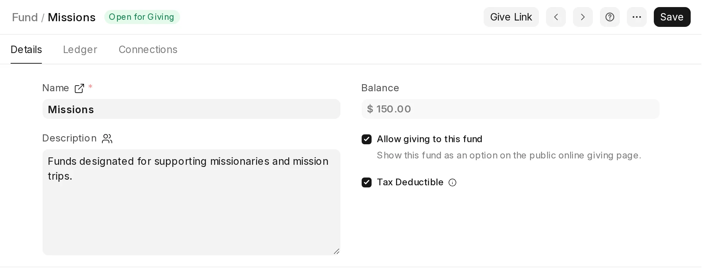

A Fund is a pot of money for one purpose, such as General, Building or Missions. Every gift goes into a fund, and every expense comes out of one. Churchit keeps the **Balance** of each fund from these records, so you cannot type it.

<picture>
  <source srcset="../../churchit/public/manual/finances/funds-dark.webp" media="(prefers-color-scheme: dark)">
  
</picture>

:::note[Example]
The church raises money for a new roof. You add a Building Fund with a Goal Amount of $40,000, tick Allow giving to this fund and print its QR code. Gifts in collections and online go into it, the Goal Progress shows how far you are, and the roofing invoice is an expense from the same fund.
:::

- The **Ledger** tab lists every transaction of the fund: the gifts, the expenses and the fund transfers. A gift takes the date of its collection.

- The **Fundraising Goal** section holds a **Goal Amount**, the **Goal Progress** and the start and end dates.

- **Allow giving to this fund** puts the fund on the Give page.

- Two funds of one church cannot have the same name.

- Do not type rows in the Ledger by hand: the balance follows the rows. Use a fund transfer or an expense instead.

## Move money between funds

To move money from one fund to another, add a Fund Transfer and submit it. Churchit adds a transaction to each fund, such as "Transfer to Building". When a transfer would take the From Fund below zero, Churchit warns you when you save it. To record money that is spent, add an Expense instead.

## Tax Deductible

Giving statements are tax receipts, so they show only gifts to funds that have **Tax Deductible** ticked. New funds have it ticked. Untick it for a fund whose gifts are not tax deductible, for example a collection that you pass on to another organization.

## Fund reports

The fund reports are in the **Fund Activity** folder: Fund Balances, Fund Transactions, Transactions by Date, Fund Goals (the funds with a goal, with what is left to raise) and the **Fund Goals Dashboard**, which shows the balance of each fund and the progress toward each goal.

The **Income Statement**, in the Accounting folder, shows the income, the expenses and the net of each fund, for the last 12 months at first. The transaction reports name the record behind each row: a Collection, an Expense or a Fund Transfer.

## Funds with more than one church

A fund belongs to one church until you tick **Shared with All Churches** on it. Then every church can give to it and spend from it, for example a joint building fund. Its balance and its transactions are the joint ones.

Each gift and expense still belongs to the church that gave or spent it, so the reports show each church only its own money. Only the church that shared a fund can stop sharing it, and only the church that owns a fund can move its money with a transfer.
