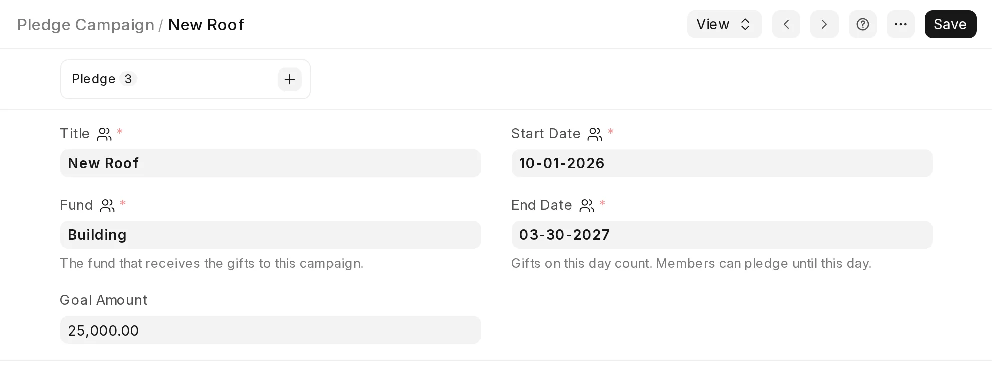

A pledge is a promise to give a total amount to a campaign, such as $1,200 to the building campaign over a year. Churchit follows how much of each pledge has come in.

<picture>
  <source srcset="../../churchit/public/manual/finances/pledges-dark.webp" media="(prefers-color-scheme: dark)">
  
</picture>

:::note[Example]
The church starts a building campaign for one year, with the Building Fund. The Smith family pledges $1,200. Each month they give $100 to the Building Fund, in the collection or online. The Pledge Progress report shows their $1,200 pledged, the amount given so far and the amount still to give.
:::

## Start a campaign

Add a Pledge Campaign with a title, the fund that receives its gifts, a start date, an end date and, if you want, a goal amount. Each campaign belongs to your church. On a saved campaign, click **View**, then **Pledge Progress**, to see its report.

## Record a pledge

Add a Pledge with the person, the campaign and the pledged amount. **Frequency** records how often the giver plans to give, and does not change the amount.

- Set **Family** to make it a household pledge: the gifts of everyone in the household then count, and each adult of the household can see it in the member portal.

- When one person has two pledges to one campaign, their gifts fill the older pledge first.

## Pledges in the member portal

Members pledge on the **Pledges** page of the member portal. A member clicks **Make a pledge**, chooses a campaign of their church that has not ended, and types the amount and how often they plan to give. The page lists the member's pledges, also the ones that staff entered from a pledge card, with the amount given and the amount still to give.

A member can change a pledge that they made while its campaign is open, but not a pledge that staff added. While the church takes gifts online, each pledge has a **Give toward this pledge** button that opens the Give page with the campaign's fund chosen.

## Pledge Progress

The Pledge Progress report shows each campaign with its goal, the total pledged and the total received, then each pledge with the amount received from its giver. A gift counts when its collection is submitted, it goes to the campaign's fund, its collection belongs to the campaign's church, and its date is in the campaign's dates. Enter each gift in a collection as usual: there is no separate pledge payment.
