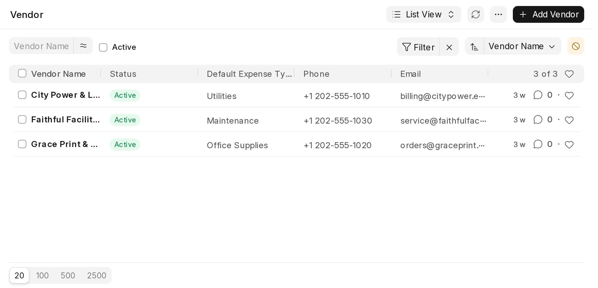

A Vendor is a company or person that the church pays, such as the electric company or a plumber.

<picture>
  <source srcset="../../churchit/public/manual/finances/vendors-dark.webp" media="(prefers-color-scheme: dark)">
  
</picture>

- **Add Vendor** opens a short form for the name, the **Default Expense Type**, the phone and the email. Click **Edit Full Form** for the address and notes.

- The Default Expense Type fills in Type when you choose the vendor on an expense.

- Tick **Is a Business** for a company, shop or organization (see [Suggest Type with AI](expenses.md#suggest-type-with-ai)).

- Untick **Active** on a vendor that you no longer use. Do not delete it: its past expenses keep their link, and new expenses do not offer it.

- A vendor's expenses are in the Connections section of its form.
