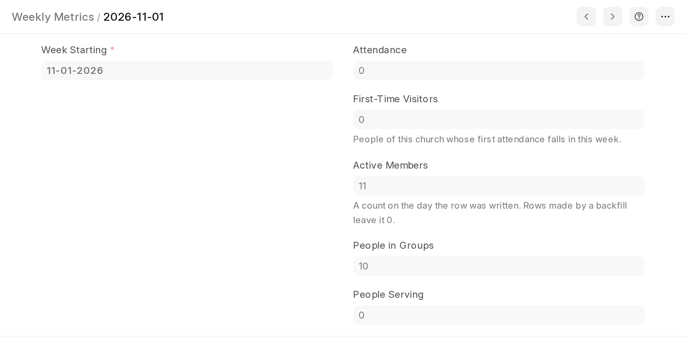

Weekly Metrics keeps the numbers of each week, so you can see how the church is doing over time: attendance, first-time visitors, active members, people in groups, people who serve, and giving and givers. Churchit writes one record for each week (and for each church, with more than one) by itself every night. You find it in the Setup folder of the Summary sidebar.

<picture>
  <source srcset="../../churchit/public/manual/foundations/weekly-metrics-dark.webp" media="(prefers-color-scheme: dark)">
  
</picture>

:::note[Example]
The elders want to know whether Easter brought lasting growth. They open Weekly Metrics and compare the attendance and the first-time visitors of the ten weeks after Easter with the same weeks of last year.
:::

- Each night, Churchit writes this week and counts last week again, so a late check-in or a late collection still counts. Members, groups and serving are counted on the day the record is written.

- When you submit or cancel a collection of an older week, Churchit counts the giving of that week again.

- You cannot add or change a record by hand. A Church Manager can delete one.

**What the numbers count.** Attendance adds the attendance of each function that starts in the week. A function shared with all churches counts once, for the church that shared it. Giving adds every submitted collection of the week, the same total as the Weekly Giving chart, with sign-up and form payments. Givers counts each person who gave money in the week once.

Only Church Finance, Church Manager and System Manager users see the giving numbers. The **Summary** workspace shows the Attendance by Week chart, the Giving by Week chart (for finance users and managers) and the **Weekly Attendance** card, which adds the attendance of this week's functions so far.

**Fill the past year.** On a new site, Church Managers can click **Fill the Last 52 Weeks** on the Weekly Metrics list. It fills the attendance, first-time visitors and giving of the past weeks in the background: refresh the list in a few minutes.

Past weeks show 0 for members, groups and serving, because Churchit cannot know those numbers for the past. A week that already has a record keeps its numbers. If you change the first day of the week in System Settings, the weeks around the change overlap.
