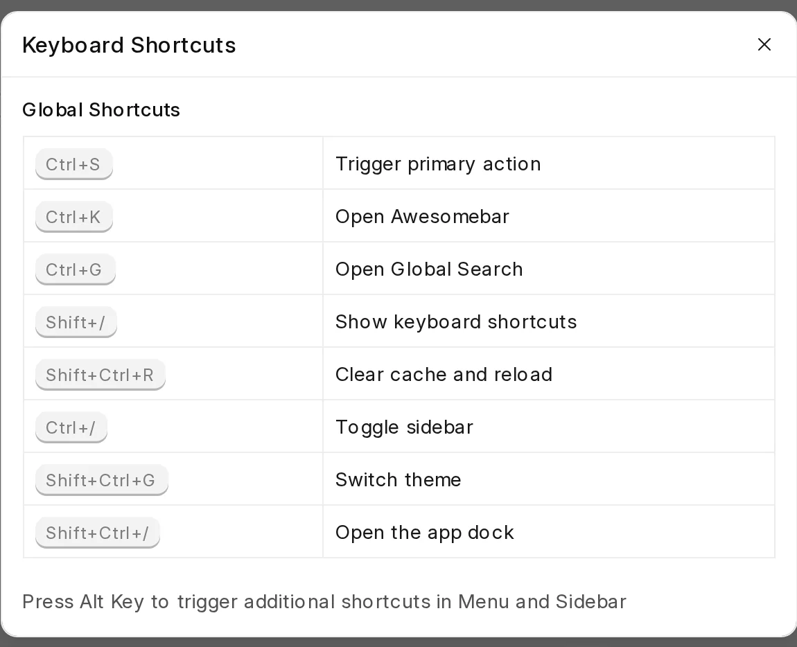

Press **Shift+/** on any page to see all the shortcuts of that page. The most useful:

- **Ctrl+S** saves the form.
- **Ctrl+K** opens Search.
- **Ctrl+G** opens Global Search.
- **Ctrl+Shift+R** reloads the page, if something did not load correctly.

<picture>
  <source srcset="../../churchit/public/manual/help/keyboard-shortcuts-dark.webp" media="(prefers-color-scheme: dark)">
  
</picture>
