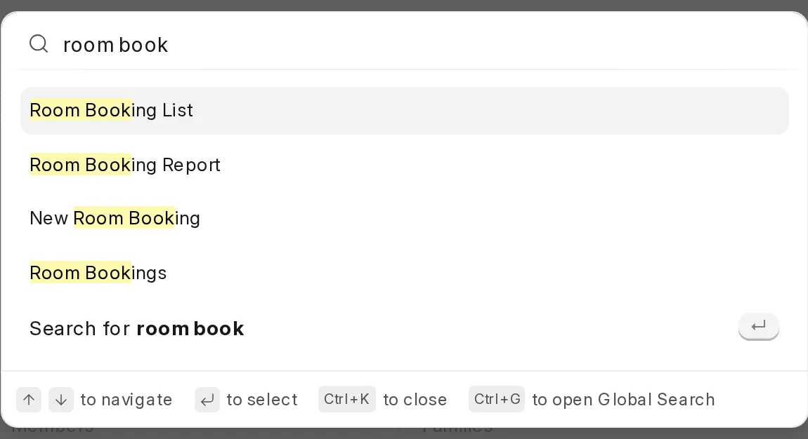

Press **Ctrl+K** (or click **Search** at the top of the sidebar) to jump almost anywhere:

- **New Person** opens a new Person form. This works for any kind of record.
- **Person List** opens the list of people, and **Person Report** opens it as a table.
- Type the name of a sidebar page, such as Families or Room Bookings, to open it.
- Type a name and "in Person", such as Samuel in Person, to open the People list with only the people of that name.

<picture>
  <source srcset="../../churchit/public/manual/help/search-dark.webp" media="(prefers-color-scheme: dark)">
  
</picture>

To find a record by its name, type the whole name, such as Marjorie May, and press Enter, or press **Ctrl+G** for Global Search. This finds the people, families, groups, sermons, sermon series, functions, songs, ministries, missionaries, missionary agencies, funds, vendors, rooms, locations, assets, bulletins and beliefs that you may open.

Prayer requests, care requests, counseling cases and notes about people never show here. A new or renamed record shows within 15 minutes. For a short or common name, open the list and type it in the name filter.

In any field where you choose a person, you can also type a nickname, a phone number or an email address.
