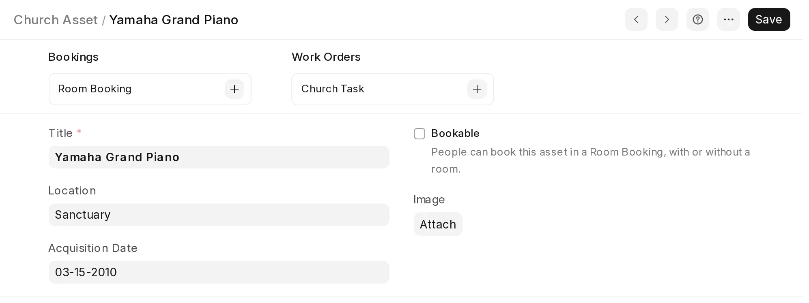

A Church Asset is something the church owns and wants to keep track of, such as a projector, a piano, a van or a set of folding tables. Church Managers add and change assets. Church Staff can read them.

<picture>
  <source srcset="../../churchit/public/manual/operations/assets-dark.webp" media="(prefers-color-scheme: dark)">
  
</picture>

To add an asset, open **Assets**, click **Add Church Asset**, give it a short title that people will recognize, such as Epson projector (fellowship hall), and choose its **Location**. Add the **Acquisition Date**, a photo in **Image**, and details such as the serial number or the purchase price in **Notes**.

- Tick **Bookable** to let people book or borrow the asset (see [Book equipment](room-bookings.md#book-equipment) and Lend equipment under Room Bookings). To see only bookable assets, tick Bookable at the top of the list.

- The **Bookings** section at the top of an asset shows the bookings and loans that hold it. **Work Orders** shows the repairs that name it.

- You cannot delete an asset that a booking or a task names.
