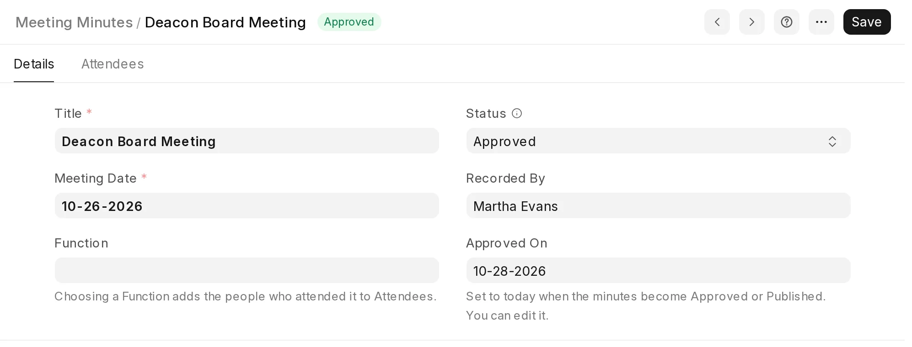

Meeting Minutes keep the record of a board, elder or committee meeting: who was there, what was decided and, if you want, the recording.

<picture>
  <source srcset="../../churchit/public/manual/operations/meeting-minutes-dark.webp" media="(prefers-color-scheme: dark)">
  
</picture>

1. Open **Meeting Minutes** and click **Add Meeting Minutes**. You are filled in as **Recorded By** when your user has a Person record.

2. Type a **Title**, such as Elders meeting, and fill in the **Meeting Date**. If the meeting was a [Function](../ministries/functions.md), choose it: the people who attended the Function are added to **Attendees**.

3. Write the minutes in **Minutes** on the Details tab, and list who was present on the **Attendees** tab. A person can be on only one row.

4. If the meeting was recorded, attach the audio file in the **Recording** section. You can play it from the form. Only audio files are accepted.

## Status and who can read the minutes

Minutes move through **Draft**, **Reviewed**, **Approved** and **Published**. Only Church Managers can read minutes that are Draft, Reviewed or Approved. Church Staff can read them only when they are Published.

When you set the status to Approved or Published, **Approved On** gets today's date if it is empty. You can change the date, but it cannot be before the Meeting Date.

:::note[Example]
The secretary writes the elders' minutes as Draft and sets them to Reviewed after the chairman reads them. At the next meeting the elders approve them, and the secretary sets Approved. Then the minutes are Published, so that the church staff can read them.
:::

Churchit ships a **Meeting Minutes Published** notification that emails the minutes to the Church Managers when they are published. It is off. To use it, a System Manager duplicates it and turns the copy on (see [Shipped notifications](../communications/notifications.md#shipped-notifications) in the Communications manual).

## Find Action Items with AI

When AI is turned on (see the [Foundations manual](../foundations/README.md)), a Church Manager can ask the AI for the tasks in saved minutes that have text. Click **Actions**, then **Find Action Items**.

1. The dialog lists each task with its owner as the minutes name them, a due date and a priority.
2. Click **Open** beside a task. A new [Church Task](tasks.md) opens in a new tab, filled in and not saved.
3. Check it, change what you want and save. Then assign it to a person (see [Tasks](tasks.md)).

Only the tasks that you save exist. The AI never assigns a person and never saves a task. Minutes are private records, so this button needs an AI model that keeps no copy of your data (see the [Foundations manual](../foundations/README.md)). Do not share the AI chat that holds the minutes.
