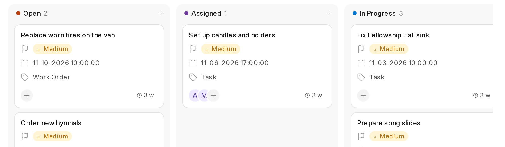

A Church Task is a job that someone must do, such as Order communion cups or Fix the leak in the kitchen. Give it a due date and a priority, assign it to a person, and Churchit reminds them before it is due.

<picture>
  <source srcset="../../churchit/public/manual/operations/tasks-dark.webp" media="(prefers-color-scheme: dark)">
  
</picture>

Church Managers add tasks. Church Staff can change tasks, for example to move them to In Progress or Completed, but cannot add them.

## Add and assign a task

1. Open **Tasks** and click **Add Church Task**.
2. Type the **Title**, and set the **Due Date** and the **Priority** (Low, Medium, High or Urgent).
3. Save.
4. To give the task to a person, click **Assign** in the sidebar of the task and choose the user.

When you assign an Open task, its status changes to **Assigned**, and the person gets a notice. The assignment takes the title, the due date and the priority of the task, and follows them when you change them. You can assign only users who can see the church of the task. Church Staff can assign tasks, because they can change them. An Urgent task shows as High priority on the To Do. On the task list, **My Tasks** shows the tasks assigned to you.

The day before a task is due, each person assigned to it gets an email and a desk notification, unless the task is Completed. A task that nobody is assigned to sends no reminder. To change the message or the number of days, a System Manager opens the [Church Task Due](../communications/notifications.md) notification.

When you set the status to **Completed**, all assignments of the task close.

:::note[Example]
The pastor adds the task Order communion cups, due next Friday, and assigns it to Tom. The task changes to Assigned and Tom gets a notice. On Thursday Tom gets a reminder email. He orders the cups and sets the task to Completed, which closes his To Do.
:::

## Bigger jobs

- **Sub-tasks**: tick **Is Group** on the main task, then make new tasks and choose the main task in **Parent Task**.

- **Linked Records**: to link the records that a task is about, such as a Person, a Room or a Function, add rows in **Linked Records** with an **Item Type** and an **Item**. Tick **Done** on a row when that part is finished.

:::note[Example]
The task Prepare the church picnic has linked rows for the picnic Function, the Pavilion room and Karen, who brings the grill. When Karen confirms, you tick Done on her row.
:::

## The Tasks Board

The **Tasks Board** shows the open tasks as cards, in a column for each status: Open, Assigned and In Progress. Drag a card to another column to change its status. To complete a task, set its status to Completed on its form. Open the board from the workspace, or choose **Kanban** in the view menu at the top of the task list.

## Work orders

A work order is a task for a repair or a job on an asset or a room. Set **Type** to **Work Order**. The Work Order section then shows **Requested By** (the person who asked), **Asset** and **Room**. The asset, the room and the person must belong to the church of the task, or be shared with all churches.

The Open Work Orders report (in the Reports folder) lists the work orders that are not Completed, the earliest due date first. The Work Orders section on an asset or a room shows how many work orders name it.

:::note[Example]
An usher finds a leak over the choir loft. The office adds a task Fix the roof leak, with Type Work Order, Room Sanctuary, Requested By the usher and Priority High, and assigns it to the maintenance volunteer. It stays on Open Work Orders until it is Completed.
:::