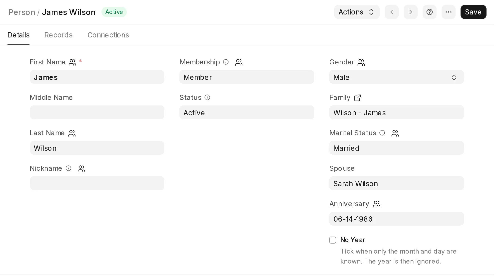

A Person is one record for each human being your church knows: members, regular attenders, visitors, children, and contacts such as a missionary's supporter. Everything else in Churchit links to the person: their family, their groups, their attendance, their giving and the care they received.

<picture>
  <source srcset="../../churchit/public/manual/people/person-dark.webp" media="(prefers-color-scheme: dark)">
  
</picture>

:::note[Example]
Maria visits for the first time and fills in a Connection Card. Churchit adds her as a Person with the Membership Visitor. Over the next months she joins a small group, and the office adds her baptism as a life event. When she joins the church, the office adds a Membership life event, and her Membership changes to Member.
:::

## Add a person

1. Open **People** and click **Add Person**.
2. Type the **First Name** and **Last Name**. While you type, Churchit warns you if a person with the same name and email or phone may already exist.
3. Choose the **Membership** and pick the **Family** if the person belongs to one.
4. Add their email, phone and address in the **Contact** section, and the **Birth** life event in **Life Events**.
5. Save.

The form has three tabs, and a **Church Fields** tab when your church adds its own fields:

- **Details**: the name, membership and household at the top, then Other Names, Health and Emergency, Contact, Life Events and Relationships.

- **Records**: the envelope number, how the person was added, Roles and Gifts (positions and skills), Directory and Portal (the photo, the directory choices and the portal login) and Letters to the Church.

- **Connections**: the person's records in groups: Involvement, Care, Giving, Membership and Follow-up, and figures such as Last Attended and Times Served. Each group shows only to the roles that can read it.

Click the (i) next to a label to read the help for that field, or click **...**, then **Take the Tour**, for a short tour of the form. The People list opens on Active people. Clear the Status filter at the top to see everyone.

## Membership and Status

These two fields say how the person is connected to the church:

- **Membership**: **Member**, **Regular Attender**, **Visitor** or **Contact**. When you add a **Membership** life event, Membership changes to Member. You can add more membership types.

- **Status**: **Active** for everyone who still takes part. When someone leaves, set it to **Inactive** and pick the **Inactive Reason**, such as Moved away. **Inactive Since** shows the day the status changed, and is cleared when the person becomes Active again.

Reports, the Church Directory, the Members card and the bulletin count a person as a member only when Membership is Member and Status is Active. The Visitor Log shows new people whose Membership is Visitor or empty. The **New Members (30 days)** card counts the active members whose first Membership life event is in the last 30 days.

Two Inactive Reasons are set for you and cannot be deleted or renamed: **Deceased** (when you add a Death life event) and **Transferred to another church** (when you confirm a member transfer out). Add your own on the Inactive Reason list.

**Source** shows how the person was first added: Desk, Import, Check-In, Connection Card, Portal, Sign-Up or Form. It never changes.

## Life events, birthdays and ages

Record birth, baptism, membership, marriage and death in the **Life Events** table.

- The **Birth** event fills in **Birth Date** and **Age**, so you do not type them. When you know only the month and day of a birthday, enter any year and tick **No Year**: the birthday still counts, but Birth Date and Age stay blank.

- A **Death** event ticks **Deceased**, fills in **Deceased Date**, sets the Status to Inactive and, if no Inactive Reason is set, the reason to Deceased. The person's spouse becomes Widowed. People who have died are left out of the birthday and anniversary lists and cards, the bulletin, the Church Directory, the Rolodex, the Check-In Station and Church Emails.

- A date cannot be in the future, and a death or anniversary cannot be before the birth. A person has one Birth and one Death event.

- When you add a person who has died to a function's attendance after the date of death, or to a group, a sign-up or a pledge, Churchit saves it with an orange warning. History is often entered late.

**Life Stage** is Adult or Child. It comes from the person's household role in their family, or else from their age: a person is an Adult from the **Adult Age** in **People Settings** (18 at first). Ages and life stages update every night.

**Birthdays This Week** and **Birthdays This Month** (in the Dates folder) list each birthday on its date this year, with the age that the person turns. A February 29 birthday is listed on February 28 in other years. A week starts on the first day of the week in System Settings (Sunday on a new site).

## Names

- **Middle Name** sits between the first and last names, and **Nickname** under the last name.

- Click **Other Names** to add a **Prefix** (Mr., Mrs., Dr., Rev.), a **Suffix** (Jr., Sr., III) and a **Previous Last Name**, such as a maiden name. A search for a person also finds the nickname and the previous last name.

- **Display Name** is filled in for you: the nickname (or the first name), the last name and the suffix, such as Bob Smith Jr.

- You cannot change a person's ID. To correct a name, change the First Name or Last Name. To join two records of one person, merge them (see below).

## Emails, phones and addresses

A person can have several emails, phone numbers and addresses, each in its own table.

- **Primary**: the first row is the primary one, and only one row in each table can be primary. Church Emails, the directory, the Rolodex, greetings and portal invitations use the primary email and phone. Ticking a new primary row unticks the old one.

- **Mailing**: tick it on the address that gets mail from the church. **Returned** shows that mail sent there came back.

- **Bounced** on an email shows that email to this address came back. Church Emails skip it, and the form shows an orange line when the primary email has bounced (see the [Communications manual](../communications/README.md)). Churchit clears it when you change the address.

- An email or phone number can be on one person only, so the same person is not entered twice. Churchit matches phone numbers however they are written: (202) 555-0147 and 202.555.0147 are the same.

**Shared emails and phones.** When two people really use the same email or phone, such as a couple's shared email or a child using a parent's phone, enter it on both. Leave **Shared From** blank on the row of the owner, usually the person who uses it to sign in to the member portal. On everyone else's row, set Shared From to the owner. A family may use a member's email or phone without Shared From.

:::note[Example]
John and Mary Smith share the email smiths@example.com. John signs in to the member portal with it, so on John's row Shared From is blank. On Mary's row, Shared From is John. A Church Email to both of them goes to the address once.
:::

## Marriage and family

The third column at the top of the Details tab shows the person's family and marriage.

- **Marital Status** is Single, Married, Widowed or Divorced. **Spouse** and **Anniversary** show only for Married and Widowed people.

- When you give a Married person a spouse, the spouse is linked back as Married and shares the anniversary. The couple shares one family: if only one has a family, the other joins it. If neither has one, Churchit makes a family named after the person you save.

- When you set a person to Divorced or Single, the marriage ends for both people: the spouse and the anniversary are removed from both.

- A Widowed person keeps the spouse and the anniversary.

- When a married person moves to another family, their spouse moves too if they were in the same family.

- **No Year** under the anniversary works as for birthdays.

**New Family From Person.** Click **Actions**, then **New Family From Person**, to make a family for a person who has a last name and is not yet the primary contact of a family, such as a married son who starts his own household. The person becomes its primary contact. If a family with that name already exists in your church, the person joins it instead.

## Health and emergency

- **Medical Notes** is for health information that the church needs to know, such as a condition or a medicine. Only Church Manager, Church People Editor and Church Check-In users can see it, and only Church Managers and Church People Editors can change it. It is never printed, and members do not see it in the member portal. The Check-In Station shows it to check-in volunteers.

- **Emergency Contact Name** and **Emergency Contact Phone** are for someone with no household adult in Churchit, such as a visiting child. The same users see them.

- **Allergies**: the member can change it in the member portal. The Check-In Station shows it, and name tags can print it.

Changes to fields that only some users can see do not show in the timeline of the person.

## Roles in the church

Add the person's roles, such as Elder or Sunday School Teacher, in the **Positions** table on the Records tab, with a start and end date. You can add more position types.

- On a position type, **Assign to Person** adds the position to a person.

- Tick **Is Single-Person Role** for a role that one person holds at a time, such as Pastor. Churchit then refuses to give it to a second person of the same church while someone holds it with no End Date.

- The End Date of a position cannot be before its Start Date.

- The **Person Positions Ending This Month** report shows the positions that end in the next 60 days.

## Photo and the directory

Add a photo on the Records tab. It shows in the Church Directory, the member portal's directory, group lists, the Rolodex and the Check-In Station.

In the **Directory and Portal** section:

- **Show Email in the Member Directory**, and the same boxes for Phone, Address and Birthday, decide what other members see in the member portal's directory. New people start with the choices in People Settings (**New People Show Their Email** and the others): email, phone and birthday shown, address hidden. People added from a card or a first portal sign-in share nothing until they choose. Members change these choices themselves in the member portal.

- **Hide from Directory and Bulletin** leaves the person out of the printed Church Directory, the member directory, and the birthdays and anniversaries of the bulletin.

- **Keep Out of Churchit's AI Features** keeps the person away from AI (see the [Foundations manual](../foundations/README.md)).

## Other records on the person

- **Letters to the Church** (Records tab): letters from this person (see [Letters](../communications/letters.md) in the Communications manual).

- **Activity** at the bottom of the form: who opened the record, the person's notes, visits, care requests, member transfers, connection cards and life events, each on its day. Each kind shows its 20 newest records, and a life event shows only when its full date is known. You see only what your role and your church let you open.

- **Alert** notes show in red at the top of the form (see [Person Notes](#person-notes)).

- The form also shows a line with the person's latest background check, and **Unsubscribed from Church Emails** when they stopped all Church Emails.

## School grade

Type the year that a child finishes high school in **Graduation Year**. Churchit shows the school grade in **Grade** and updates it each day: Kindergarten in the school year that starts 13 years before graduation, then Grade 1 to Grade 12, then Graduated. The grade goes up on the first day of the month in **School Year Starts In** in **People Settings** (August at first). The Graduation Year field shows for children, and for adults who have one.

:::note[Example]
With the school year starting in August, a child with Graduation Year 2030 is in Grade 8 on July 31, 2026 and in Grade 9 on August 1, 2026.
:::

## Envelope numbers

**Envelope Number** is the number on a person's offering envelopes, or the reference on their bank gifts. Two people in one church cannot have the same number. Type it in any Person field, such as a donation row, to find the person. A signed-in member sees it on the Give page as the reference to use.

## Member QR Card

The **Member QR Card** print format prints a wallet card, the size of a bank card, with the church name, the person's name, photo and a QR code. Open the person, click the print icon and choose Member QR Card. At the Check-In Station, the person shows the card to the camera with **Scan Card** to check in quickly.

## Skills, interests and spiritual gifts

Use **Skills, Interests and Gifts** on the Records tab to record what the person can do, what they like to do and their spiritual gifts. Each Skill has a category: Skill, Interest or Spiritual Gift. Churchit starts with twelve spiritual gifts from Romans 12, 1 Corinthians 12, Ephesians 4 and 1 Peter 4. Church Managers and Church People Editors can add more.

:::note[Example]
You need people who can play the piano. Open the People list in Report view, add a filter on Skill (Person Skill) equals Piano, and save the report. You can then email the list or keep it as a smart list (see [Lists of People](lists-of-people.md)).
:::

## Relationships to other households

Use the **Relationships** table to record a relative who lives in another household, for example a grandparent. Record the relationship on one person only: the other person sees it on their Connections tab. Use the Family's Members table for people in the same household: you cannot choose the person themselves or someone in the same family.

## Church fields

A System Manager can add the church's own fields to the Person and Family forms, for example a T-shirt size:

1. Open **Customize Form** and choose Person or Family.
2. Find the row **Church Fields** at the end of the fields table, and add the new field below it. Do not tick **Mandatory**: Churchit adds people from cards, imports and the member portal without church fields.
3. To show a Person field only to Church Managers, Church People Editors and check-in users, set its **Perm Level** to 1. Do not set a Perm Level on a Family field: nobody could see it.
4. Click **Update**.

The field shows on the Church Fields tab, and you can filter lists on it. When a later update moves fields on the form, open Customize Form, choose Person or Family and click **Actions**, then **Reset Layout**. Your fields stay. Never use Reset All Customizations, which deletes them.

## Birthday and anniversary emails

Churchit can email a greeting to each person on their birthday, and to each married couple on their anniversary. A System Manager turns on a copy of the **Birthday Greeting** or **Anniversary Greeting** notification (see [Notifications](../communications/notifications.md) in the Communications manual) and can change its words.

- The birthday greeting goes to the primary email of each active person whose birthday is today, also with No Year.

- The anniversary greeting goes to the primary contact of the family when that person is married, and names both spouses. A Widowed person gets none.

- People who have died get no greeting. Hide from Directory and Bulletin does not stop the greetings.

- To send a greeting some days early, type the number of days in **Days Before or After** on the copy.

## Merge two records of one person

When one person has two records, merge them. Open the record that you do not want to keep, click **...**, then **Merge Into...**, choose the person to keep and click **Merge**. Only users who can delete people, such as a Church Manager, can merge.

:::caution[Merging two people]
You cannot undo a merge. The removed record is deleted for good.
:::

When both people have a different value for a detail, the merge window shows a table: choose the value to keep in each row. The rest moves by itself:

- Everything that names the removed record moves to the kept one: attendance, giving, groups, ministry teams, care, prayers, comments, attachments and history.

- Emails, phones, addresses, life events, positions, letters, skills and relationships are added to the kept record, without repeats. The kept record's primary email, phone and address stay primary.

- The portal login moves to the kept record when it has none. The kept person stays in their own family, or joins the family of the removed record when they have none.

- A Possible Duplicate for the two is marked Merged.

Churchit refuses to merge two people who both have a portal login, who have different spouses, who are married to each other, or who belong to different churches. A Portal User or an Envelope Number that the other person still has cannot move: clear it on that person first. When both records came from an import, merge them in the old system too, or the next import adds the record again.

## Remove the personal data of a person

When a person asks the church to forget them, a Church Manager or a System Manager opens the person and clicks **...**, then **Remove Personal Data**. The record stays, with the first name Anonymized and the last name, so that their giving and attendance still count in reports.

:::danger[Removing personal data]
You cannot undo Remove Personal Data.
:::

- Churchit removes the names except the last name, the emails, phones, addresses, letters, photo, medical notes, emergency contact, allergies, anniversary, skills, church fields, portal login and Imported ID. The person is hidden from the directory, and the portal login is disabled.

- The Birth life event is removed. Other life events keep their type and date, so the yearly counts stay right.

- The person leaves their family and their spouse, and loses their relationships. A family with no members left is anonymized too.

- Records about the person lose their history, comments and attachments: background checks, care requests, counseling cases, giving statements, serving assignments and others. Their Person Notes, Connection Cards, Form Responses, group join requests and the Pickup Restrictions that protect them are deleted. Their open follow-up cards are closed. Their answers and typed details on function sign-ups are removed, also on guest sign-ups made with one of their email addresses. Their Gender becomes Unknown, and the family name loses their first name.

- Emails and texts sent to the person lose their address and text. Other records that name the person keep the link but lose the person's name and email.

- AI chats and suggestions about the person and their requests are deleted (see the [Foundations manual](../foundations/README.md)).

When a System Manager approves a member's Personal Data Deletion Request, Churchit removes the data in the same way.

**On a schedule.** In **People Settings**, set **Remove Personal Data After (Years Inactive)**. Each day, Churchit then removes the personal data of up to 50 people who have been Inactive that long, the earliest first, and adds a comment with the reason. People who have died are kept. 0 (the default) never removes data. The Personal Data Due for Removal report (in the Data folder) shows who is next and when. To keep a person's data, set their Status back to Active before that date.

:::caution[Deleting a person]
Deleting a person is different: it removes the person from their family and spouse, removes the relationships that others have with them, and deletes their membership history, so they drop out of the Membership Changes report. Use Remove Personal Data when someone asks to be forgotten, and Merge for a duplicate.
:::

## Person Notes

Person Notes keep what staff know about a person: a phone call, a visit, or something to remember. To add one, open the person, click **Actions**, then **Add Person Note**. Pick a **Category**, write the note and save. The **Date** is today unless you change it. For a call or a visit, pick how you were in touch in **Contact**.

- A person's notes show in the Activity list at the bottom of their form, on the day each note records. Tick **Pinned** to keep a note at the top.

- Tick **Alert** to show the note in red at the top of the person's form, for example "Hard of hearing. Face him when you speak."

- You see only the notes that your role may read. Notes cannot be shared with other users, and Churchit keeps no change history of them.

**Note categories.** A Note Category decides who reads and adds its notes. Churchit starts with three: every staff member reads **General**, and only the care team and Church Managers read **Pastoral Care** and **Benevolence** (the case notes of alms requests). A Church Manager can add categories:

- **Roles That Read Notes**: the roles that can read the notes. Blank lets all staff read them.

- **Roles That Add Notes**: the roles that can add and change the notes. Blank lets all staff add them. A role that can add but not read cannot open a note again after saving it.

- **Private**: only the person who wrote a note can read it, not even a Church Manager.

With more than one church, every church uses the same categories, and only a Church Manager of the main church can change their roles.

:::note[Example]
The pastor visits Mr. Jones in hospital and adds a Pastoral Care note: "Surgery went well, home on Friday. Wife Ruth asked for meals." The church secretary, who is not on the care team, does not see the note.
:::

**Draft a Note With AI.** When AI is turned on (see the [Foundations manual](../foundations/README.md)), open a person, click **Actions**, then **Draft Note With AI**. Choose Person Note or Visitation Log, paste or type what you remember, and click **Draft**. Click **Open the Draft**: the form opens filled in and not saved. Check each field and save. Notes and visits are private records, so this needs an AI model that keeps no copy of your data. Do not share the AI chat that holds your notes.
