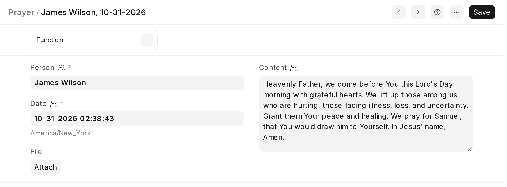

A Prayer records that someone prayed, and what for. Most Prayers come from members who tap I prayed in the member portal: Churchit makes the Prayer for them, with their note. Church Manager and Church Pastoral Care users can also add a Prayer by hand, for example for a prayer written for a service. Other staff can read Prayers.

<picture>
  <source srcset="../../churchit/public/manual/prayers/prayers-dark.webp" media="(prefers-color-scheme: dark)">
  
</picture>

To add a Prayer by hand:

1. Open **Prayers** and click **Add Prayer**.

2. Pick the [Person](../people/person.md) who prayed. With more than one church, the person must belong to your church.

3. Type the prayer, or attach a file for a written or recorded prayer.

4. In **Prayer Topics**, add a row for each thing that was prayed for. Choose the kind of record first, such as Prayer Request, Person, Function or Missionary, then the record itself. You can choose only a prayer request that you can open.

Each Prayer that names a prayer request adds one to that request's prayed count. A Prayer is titled with the name of the person and the day, such as James Wilson, Sunday, November 15, 2026. A person's prayer requests and Prayers show on the Connections tab of their Person form.
