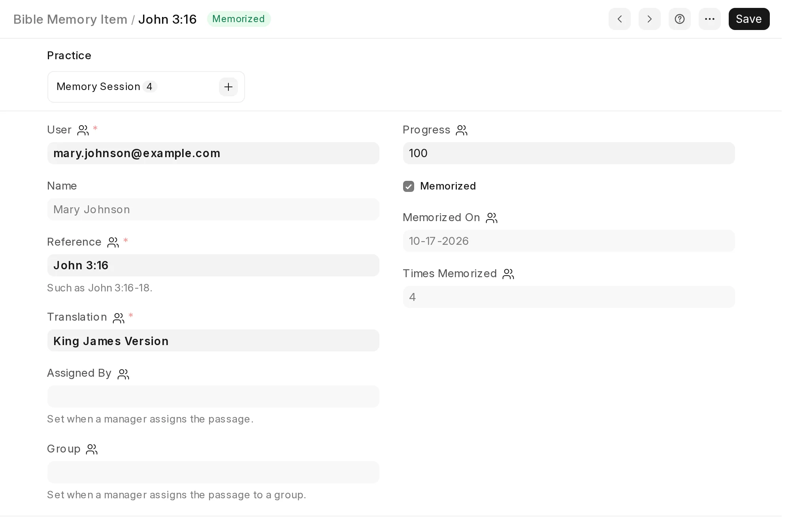

Bible Memory helps members learn Scripture by heart, in the member portal. Each member keeps a list of passages. They practice each passage until they can type it without a mistake. Staff can give the same passage to a whole group, for example a weekly memory verse.

<picture>
  <source srcset="../../churchit/public/manual/study/bible-memory-dark.webp" media="(prefers-color-scheme: dark)">
  
</picture>

Each passage on a member's list is a Bible Memory Item, and each finished practice is a Memory Session.

## Memorize a passage in the member portal

1. In the member portal, open **Bible Memory**.

2. Click **Add a passage**, type the reference, such as John 3:16-18, choose a translation and click **Add**. Only translations that are ready are offered.

3. Click **Practice** on the passage. There are two ways to practice:

- **Blur**: read the passage, click **Hide more words** to blur a few words at a time, and say it aloud. Press and hold **Hold to show** to see all the words for a moment. **Undo** and **Start again** help when you go too far. **Done** adds 5% to the progress.

- **Type**: type the first letter of each word. A run with no mistake adds 50% and counts as a perfect run. A run with one or two mistakes adds 10%. Each wrong letter takes 2% off at once.

The list shows each passage under **Learning** until its progress reaches 100%. Only Type can take a passage to 100%. Blur stops at 99%. At 100% the passage moves to **Memorized**. A mistake later takes it back to Learning, so keep practicing.

:::note[Example]
Anna adds Psalm 23. On Monday she uses Blur three times to learn it: 15%. On Tuesday she types it with one mistake: 10% more, less 2% for the wrong letter. Over the next week she types it perfectly twice and reaches 100%, so Psalm 23 moves to Memorized.
:::

A member cannot add the same passage in the same translation twice. **Remove** takes a passage and its progress off the list, also a passage that a manager assigned.

## Assign a passage to a group or to people

Church Managers can put a passage on the lists of many people at once, for example the memory verse of the month for a small group.

1. Open **Bible Memory Items** and click **Assign a Passage**.
2. Type the passage and choose its translation. You can choose only a translation that you can read.
3. Pick a [Group](../people/group.md), a **User**, or both, and click **Assign**.

Everyone in the group who has a portal login gets the passage. A dialog lists the people of the group with no portal login. Click a name to open the person, invite them to the portal, then assign the passage again.

A person who is missing from the User list has no portal login yet. Each new passage shows **Assigned by** the manager, and the group, on the member's list. If the member has the list open, a message says "A new passage is on your list". Nothing is emailed.

- If a person already has the passage in that translation, Churchit skips them. Their own item keeps no group.

- You can assign only to people of your own churches.

- A passage keeps its group when the group is deleted, but then shows no group. You cannot set the group of a passage by hand.

- In the member portal, a member can choose a group at the top of Bible Memory to see only its passages.

:::note[Example]
The youth leader assigns Psalm 23 in the BSB to the Teen Group. Mary has a portal login and gets the passage. David has no login, so the dialog names him. Sarah already learned Psalm 23 on her own, so she keeps her own passage, and it does not show under the group.
:::

## Follow progress

The Bible Memory report (in the sidebar) lists the passages with the person, the progress, the date memorized and the number of perfect runs. It opens with **Memorized** set to Yes, so it shows only the memorized passages. To see the progress of a group:

1. Open the Bible Memory report.
2. In **Group**, choose the group.
3. Clear **Memorized** to see every passage, also the ones still being learned.

The Group filter shows only the passages that the group assignment added. To see a member who had the passage before, clear Group and choose their User. Church Staff can open this report too, and see the passages of every member of their churches.

On the Bible Memory Items list, each passage shows Memorized, In Progress or Not Started. Open a passage to see its practice runs under **Practice** at the top of the form.
