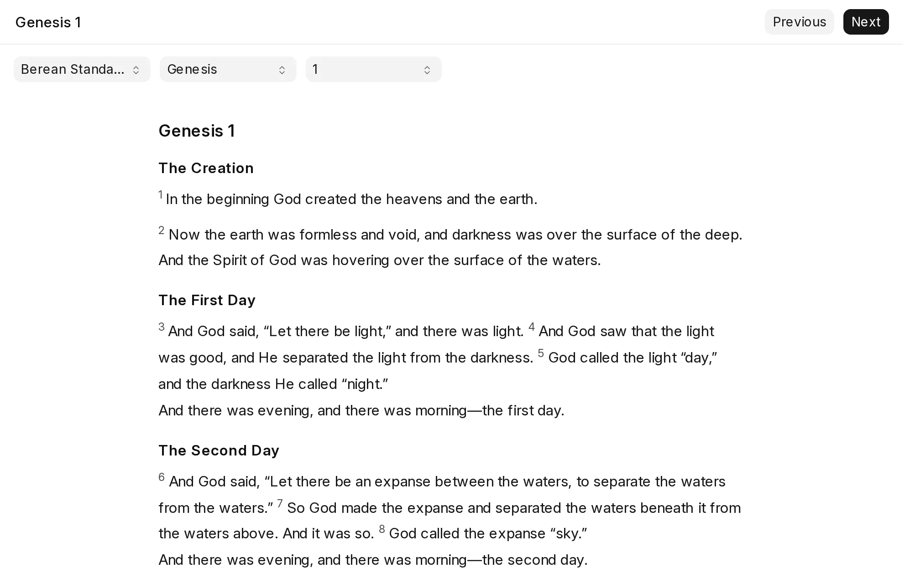

The Bible page shows the Bible one chapter at a time. Choose a translation, a book and a chapter at the top of the page, and click **Next** or **Previous** to turn the page. Each chapter has its own address, so you can bookmark it or send the link to a colleague. The desk Bible page is for staff.

<picture>
  <source srcset="../../churchit/public/manual/study/bible-reader-dark.webp" media="(prefers-color-scheme: dark)">
  
</picture>

The reader opens in your church's **Default Bible Translation**, set on the Settings tab of the [Church](../foundations/churches.md) form. A branch church with no default of its own uses the default of its parent church. The bulletin and the sermon slides also use this translation unless you choose another one.

Members and visitors read the Bible on the website at `/bible`, and members also reach it from the member portal. Visitors who are not signed in see only the free translations. Signed-in members also see the translations that your church imported.
