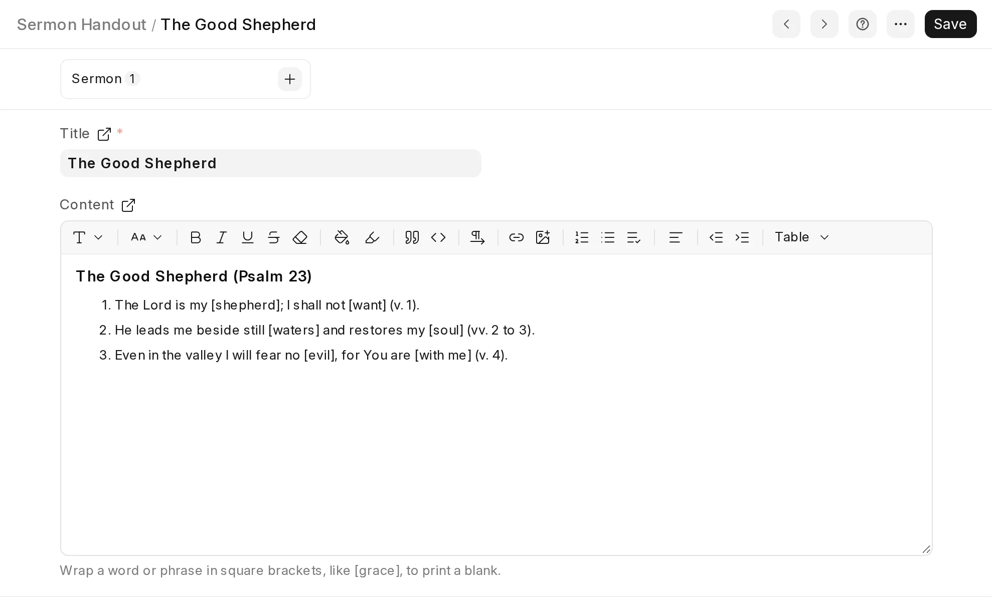

A Sermon Handout is a fill-in-the-blank outline of a sermon for listeners. It prints as the sermon notes insert of the [Bulletin](../communications/bulletins.md) of a Function that has the sermon on its schedule. It also shows on the sermon's page on the website.

<picture>
  <source srcset="../../churchit/public/manual/study/sermon-handouts-dark.webp" media="(prefers-color-scheme: dark)">
  
</picture>

To make a handout, open the sermon and click **Actions**, then **Create Handout**. The handout starts as a copy of the sermon notes, and the sermon's **Handout** field links to it. A sermon has one handout, so the button shows only while the sermon has none.

Put a word or phrase in square brackets, like [grace], to make it a blank. Listeners see an empty line on paper and an empty box on the website. You still see the words on the handout form, so the form is your answer key. Keep the handout to about half a page, because the bulletin insert has a fixed space.

:::note[Example]
The handout says "While we were still [sinners], Christ died for us." The printed bulletin shows "While we were still ________, Christ died for us." On the website, the listener types the missing word in a box.
:::