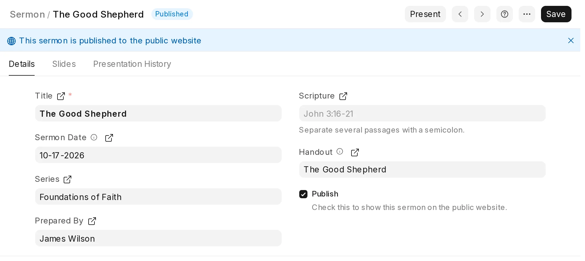

A Sermon keeps one sermon: its title, date, Scripture passage and preacher, the notes, the recording and the video, and the slides that you show while you preach. When you tick **Publish**, the sermon gets its own page on your website. If it has audio, it also goes into the podcast.

<picture>
  <source srcset="../../churchit/public/manual/study/sermons-dark.webp" media="(prefers-color-scheme: dark)">
  
</picture>

:::note[Example]
On Sunday Pastor Tom preaches on Psalm 23. On Monday the office adds a Sermon with the title The Lord Is My Shepherd, the Sermon Date, the Scripture Psalm 23 and the notes. They attach the audio, paste the YouTube link and tick Publish. The sermon now shows on the website's Sermons page and in podcast apps.
:::

## Add a sermon

1. Open **Sermons** and click **Add Sermon**.

2. Type the **Title**. Two sermons cannot have the same title. To preach a sermon again, add the new date to its Presentation History, or add the year or the series to the new title.

3. Fill in the details:

- **Sermon Date**: the date when the sermon was first preached. If you leave it empty, Churchit uses the earliest date in Presentation History.

- **Series**: the Sermon Series that the sermon belongs to.

- **Prepared By**: the [Person](../people/person.md) who prepared it.

- **Scripture**: the passage, such as John 3:16-21. Separate passages with a semicolon.

- **Notes**: the sermon notes or outline. When the sermon is published, the notes are public.

- **Transcript**: the full text of the sermon, if you have it. It is never published.

- **Audio Recording** and **Video Link** in the Recording section (see [Sermons on the Website](sermons-on-the-website.md)).

4. Save.

## Slides

On the **Slides** tab, add a row for each slide that you want to show while you preach. A slide shows either a passage of Scripture or a record of the church:

- **A Scripture slide**: leave **Slide Type** empty and type the passage in **Scripture**, such as Psalm 23. Choose a translation, or leave it blank for your church's default.

- **A record slide**: choose a Slide Type (Belief, Function, Ministry, Missionary, Person, Sermon Series or Song) and the record. Then choose which fields of the record the slide shows. Tick **Title** on the field to use as the slide title, and **Show Label** to print the field's name. Drag the fields to change their order.

With no fields chosen, the slide shows the name of the record. A Song with no fields chosen shows each part of the song, then a slide with its copyright and CCLI numbers.

- **Notes** on a slide show on the slide itself, under its content. Everyone who sees the presentation sees them.

Each slide needs a passage or a record, or the sermon cannot be saved.

:::note[Example]
Slide 1 is Scripture, Romans 8:28-30. Slide 2 is the Song Amazing Grace with no fields chosen, so its verses and its copyright follow. Slide 3 is the Belief Salvation by Grace, with its title and summary.
:::

## Present a sermon

Click **Present** on the sermon form. Churchit saves the sermon first, then opens the presentation in a new tab. Use the arrow keys or the space bar to move between slides. Press Escape or click **X** to stop.

A published sermon also has a **Present** button on the website, so anyone can follow the slides on their own device. Visitors see only the public parts: a published Belief, a published Missionary that is not Sensitive, and a Song with Public Domain ticked. Other slides show "This slide is not public". Slide notes show to visitors too.

## Presentation History

The **Presentation History** tab records each time the sermon was preached: the date, who presented it, where, notes and a recording. The website never shows these rows, but a published sermon makes their recordings public (see [Sermon Podcast](sermon-podcast.md)).

## Study with AI

When AI is turned on (see the [Foundations manual](../foundations/README.md)), a saved sermon has the button **Study with AI**. It writes study helpers from the notes and the Transcript:

- **Discussion Questions**: questions for a small group, starting with an easy one.

- **Summary**: three sentences about the sermon.

- **Series Description**: a short description of the sermon's series. **Open Draft** opens the Sermon Series with the new description filled in and not saved.

- **Handout Blanks**: picks key words of the notes. **Use** puts each one in [square brackets] in the sermon notes. Save the sermon, then click **Actions**, then **Create Handout** (see [Sermon Handouts](sermon-handouts.md)). If the sermon has a handout already, change the handout yourself.

- **Devotional** and **Social Post**: for a published sermon only, from the notes.

**Copy** puts an answer on the clipboard. The AI does not write a sermon or a prayer. Where Christian traditions differ, the questions show the main views fairly, and the AI adds no teaching that the sermon does not give. Verse text in an answer comes from your church's free default translation, never from the AI. Read each answer against your own teaching.

The notes of a sermon that is not published, and every Transcript, are church records. To send them, the AI model must keep no copy of your data (see the [Foundations manual](../foundations/README.md)). A person can use Study with AI 20 times an hour.
