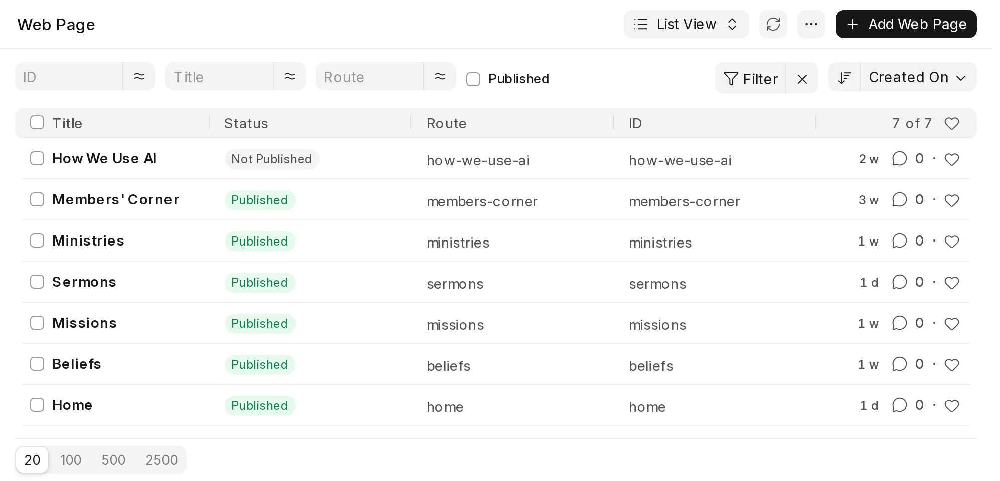

Your website starts with these pages: Home, Beliefs, Sermons, Missions, Ministries, Find a Group, Calendar, About Us, Contact Us and Give. Most of them list your records. A record shows on the website only when you tick **Publish** on it:

- **Beliefs**: the published [Beliefs](../foundations/beliefs.md).
- **Sermons**: the published sermons, the newest first (see the [Study manual](../study/README.md)).
- **Missions**: the published missionaries that are not Inactive and not Sensitive (see the [Missions manual](../missions/README.md)).
- **Ministries**: the published ministries whose status is Active.
- **Calendar**: the published functions (see [Calendar](calendar.md) below).

<picture>
  <source srcset="../../churchit/public/manual/website/website-dark.webp" media="(prefers-color-scheme: dark)">
  
</picture>

:::note[Example]
A visitor tells you that the youth ministry is missing from your website. Open the Ministry: Publish is not ticked. Tick it and save. The Ministries page and the home page show the youth ministry at once.
:::

Other pages: **Announcements** (/announcements) shows the announcements of the newest published bulletins that share them. **Bulletins** (/bulletins) is for signed-in members. **Watch Live** (/live) shows your live stream. **Locations** lists your churches when you have more than one. The **Connection Card**, the prayer request form for visitors and other forms are Web Forms.

## Change a page

Each page that Churchit ships (Home, Beliefs, Sermons, Missions and Ministries) is a Web Page record that you can edit. An upgrade of Churchit keeps your wording. It only repairs the part of a page that reads your records.

Open the page under **Web Pages**. The home page is made of blocks (see [The home page](website.md#the-home-page)). On the other pages, the content is in **Main Section (HTML)**. It is a template that reads your published records, so the page stays up to date by itself. To write a page by hand instead, change **Content Type** to Rich Text or Markdown. Put styles for one page in the **Custom CSS** tab. The look of the whole site is the Website Theme.

To make a new page, click **Add Web Page**, write it and tick **Published**. Publishing a page adds it to the end of the website menu. Un-publishing or deleting a page removes its links from the menu and the footer. A message confirms each change. Only publishing adds a menu item: editing a page that is already published does not add it again.

## The home page

The home page welcomes a visitor and shows what is happening now. It is built from blocks, one after the other:

- **Church Welcome**: the name of the church, its Mission Statement, the photo and verse of the [Church](../foundations/churches.md), when it meets, and a stream that is live now.
- **Church Events**: the next published functions, with **Register** when a function takes sign-ups.
- **Church Sermons**: the newest sermons and the podcast.
- **Church Announcements**: the announcements of the newest shared bulletin.
- **Church Ministries**: the active published ministries.
- **Church Next Steps**: links such as Find a Group and Give.
- **Church Visit**: the address, phone and email of the church.

A block with nothing to show stays out of sight.

**When the church meets.** The welcome lists each published function that repeats, for example "Weekly on Sunday at 10:00 AM". To show your Sunday service there, make it a repeating function on the calendar (see [Recurring Functions](../ministries/recurring-functions.md)). Without one, the welcome names the next function.

**Change the home page.** Open the **home** Web Page. Each row in the content table is one block: drag a row to move it, tick **Hide Block** to hide it, or click **Edit Values** to give it another title or show more items. You can also add Frappe's own blocks, such as a text section with an image. The same blocks work on any Web Page whose Content Type is Page Builder. To go back to the earlier home page, set the Content Type to HTML.

## Colors and look

The website and the member portal share one look, set like a printed bulletin: serif titles, a double line under each page title and fine lines between entries. The colors come from the **Website Theme**. To pick one, open **Website Settings** and, in the Theme section, click a theme in the picker under **Website Theme**, then save. Each card shows the light and the dark page of its theme. Click **Preview** on a card to open your home page in that theme before you save. Only you see the preview.

Churchit ships six themes: **Churchit** (warm paper with a deep red, the default), **Harbor** (navy), **Meadow** (green), **Indigo**, **Vesper** (plum) and **Slate** (gray with a teal). **Standard** is the plain white and gray of Frappe. The member portal takes the same colors, so members see one church in both places.

**Your own colors.** Open a theme in **Website Theme**, click **Duplicate** in its menu, give the copy a name and change three colors: **Background Color** is the paper, **Text Color** the ink and **Primary Color** the accent, which marks today's date and a few other things. The page stays light with dark text, and the accent stays easy to read in light and dark mode, whatever colors you pick. Then pick your theme in Website Settings.

## Live updates

An open page updates by itself a few seconds after staff publish or change something that it shows: an event on the home page, the Calendar and the Register page, a sermon on the home page and the Sermons page, announcements, and the number of ministries and missionaries on the home page. The new rows show with a short highlight. A visitor does not need to reload the page.

## Which fields the public can see

In the desk, a small badge beside a field label shows that the field appears outside the desk. An outgoing-link badge means anyone can see it. A people badge means only signed-in members can see it. Point at the badge to see which pages show the field, and click it to open one. On a phone, tap the badge. A page that is off marks no field. While the public website is off, a page that sends visitors to the login page counts as members only, so the outgoing-link badge stays only where anyone can still see the field, for example in the podcast feed.

:::note[Example]
On a Missionary form, the badge beside Photo says that the Missions page shows it to anyone. Before you add a photo of a missionary in a closed country, you know that the public would see it.
:::